<div align="center">

# 🎧 Bluetooth Turbo for PS Vita

**The PS Vita's Bluetooth sound, fixed: it works with modern earbuds, lags less, sounds the way you like, and shows your headset's battery.**

A taiHEN plugin (kernel, Settings and Home screen modules) for HENkaku/Ensō on firmware 3.60 to 3.74.

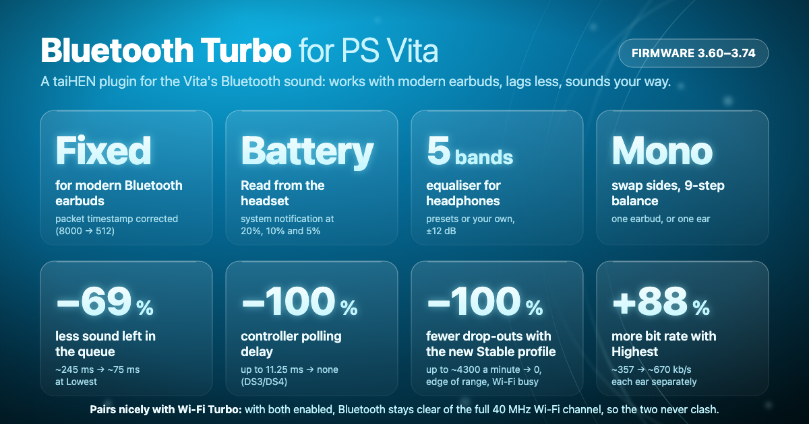

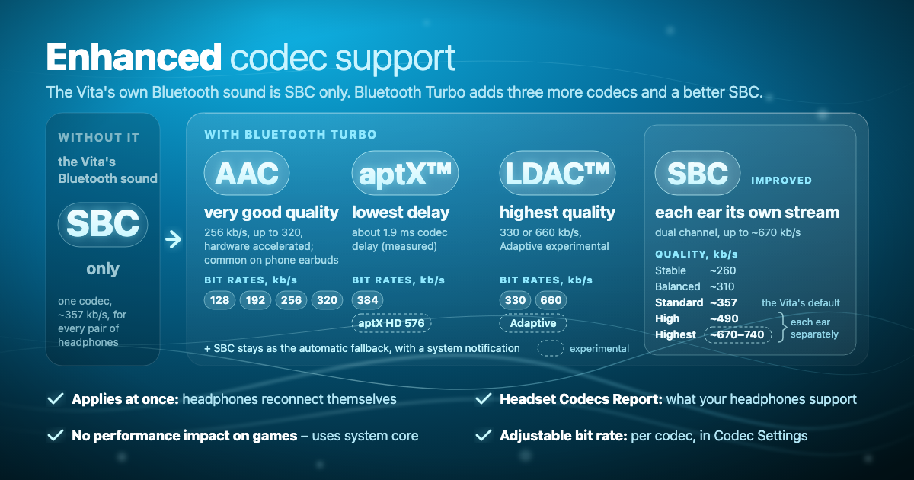

</div>

> [!IMPORTANT]
> **Firmware 3.60 to 3.74.** Tested on one console, a PS Vita 1000 at 3.60, with
> two headsets; the other versions use the same Bluetooth code but haven't been
> tested on one yet. Other firmware versions are not supported: don't install it
> there. If something doesn't work, please
> [open an issue](https://github.com/juanjsebgarcia/vita-turbo-bluetooth/issues)
> with your logs.

> [!IMPORTANT]
> **A headset that was paired before you installed and enabled Bluetooth Turbo has to be removed
> from Settings → Devices → Bluetooth Devices and paired again once, so that it sees
> the new connection.** Without that, it won't report its battery level, and a headset
> that offers only hands-free won't give the Vita its microphone.

> [!WARNING]
> **The AAC, aptX™ and LDAC™ add-ons are unofficial, optional and opt-in.**
>
> - They are unofficial ports of open-source encoders that their authors released under the
>   Apache License 2.0 ([THIRD_PARTY_NOTICES.md](THIRD_PARTY_NOTICES.md)). They are not made,
>   certified, endorsed or supported by the owners of those codecs or their trade marks, or by
>   Sony Interactive Entertainment.
> - They are separate downloads and are off unless you install them and add them to your
>   `config.txt` yourself. Bluetooth Turbo works fully without them, on the Vita's own SBC codec.
> - They come **with no warranty of any kind**, from me, from the encoders' authors or from the
>   trade-mark holders. No patent or trade-mark licence is given or implied; the names are used
>   only to say which codec an add-on is compatible with.
> - Bluetooth Turbo is a free, non-commercial hobby project. Whether you install an add-on, and
>   whether doing so is appropriate where you live, is your decision and your responsibility.
>
> See [Disclaimer](#disclaimer).

---

## Why

The Vita's Bluetooth sound has some rough edges. Most modern earbuds stay silent because each packet of
sound carries a timestamp that advances in the wrong step. When the radio is busy (Wi-Fi in use, a crowded
room) the sound can lag well behind the picture, because the Vita lets a long queue build up before it
backs off. The Vita's own sound settings never reach Bluetooth headphones. The first volume step can be too
loud for some earbuds. Its wireless controllers are put into a power-saving mode that makes their input
wait. And it never shows how much battery your headset has left. Bluetooth Turbo changes only what the Vita
sends to Bluetooth headphones and how it connects to them and to wireless controllers, and puts everything back
when you switch it off.

## Headline figures

One PS Vita 1000 on 3.60 with one headset, so read these as what happened for me. Stock is the console's own
behaviour; Bluetooth Turbo is the setting named in the first column. The drop-out counts are lost sound
packets in 3-minute runs at the edge of range with the Wi-Fi busy uploading; the latency and polling figures
are the limits the console applies (the queue length and the polling interval), not timings measured on air.

| | Stock | Bluetooth Turbo | Change |
|---|---|---|---|
| Packet timestamp step | 8000 (most modern earbuds stay silent) | **512** (they play) | **fixed** |
| Headset battery | not shown | **shown** | |
| Sound queue before the Vita backs off (*Lowest*) | ~245 ms | **~75 ms** | **−69 %** |
| Controller polling delay (*Fast*) | up to 11.25 ms | **none** | **−100 %** |
| Drop-outs at the edge of range, Wi-Fi busy (SBC Codec - *Stable*) | up to about 4300 a minute (about 290 in another run) | **0** | **−100 %** |

*Standard* lost about 290 and 4300 packets a minute in two runs; *Stable* lost none in the run between them.
At a normal distance *Standard* was clean.

## Features

- ✅ **Timing fix.** Corrects the packet timestamp, so earbuds that stayed silent can play. On whenever
  Bluetooth Turbo is on, and left alone if another plugin has already made the same change.
- 🔋 **Battery read from headset.** When headphones connect, Bluetooth Turbo opens the hands-free connection
  that headsets report their battery over (the console normally opens only the simpler headset connection), and
  shows the level on its Settings page. Headsets that don't report one show *Not Reported*.
- 🎙️ **Headset microphones on newer headsets.** Newer headsets that use the hands-free protocol can now use their
  microphone on the Vita, for voice chat and anything else that records. Before, the Vita only took the microphone
  of older headsets. (Tick *Prioritise Bluetooth® Device Microphone* on the Vita's Bluetooth Devices page.)
- 🪫 **Low headset battery notifications.** A system notification when your headset's battery falls to 20%, 10% and 5%,
  once for each drain (a notification again after the battery has risen above a level or the headset has
  reconnected), in the console's language. They can be switched off in the Settings page. A headset that
  reports in steps of 10% gives the 20% and 10% notices only; the 5% notice needs a headset that reports finer.
  *Low Battery Notifications* is greyed out while *Read Headset Battery* is off, because without the level there is nothing to notify about.
- 🔍 **Discover which codecs your headphones support.** In *Settings → Devices → Bluetooth Devices*, the headphones' own page
  lists their codecs under *Headset Codecs*, for example *SBC, AAC, aptX, aptX Adaptive (unsupported)*: the ones Bluetooth Turbo can
  use by name, *(add-on available)* when the add-on that would use one isn't installed, and *(unsupported)* for codecs the Vita can't
  use. The list is remembered for each pair of headphones; if it says *Not Known Yet*, press *Refresh Codecs* to read it.
- 📡 **Link details on the headphones' own page.** In *Settings → Devices → Bluetooth Devices*, on the page of the headphones that are
  playing: *Codec*, *Headset Codecs*, *Sample Rate*, *Bluetooth Latency*, *Headset Battery* and *Signal* (*Excellent*, *Good*, *Fair* or
  *Weak*, from the Bluetooth chip's own link quality and signal strength, taken together; *Measuring…* for the few seconds after the
  headphones connect). Sony's own *Profiles* row there also names the hands-free link Bluetooth Turbo opens: *A2DP,AVRCP,HFP*
  (or *HSP* when only the console's own headset link is up). The values are read when you open the page; open it again to see new ones.
- 🧭 **Bluetooth Codec Help.** A sub-page above *Bluetooth Codec* with six short lines on choosing a codec (check your headphones'
  codecs first, then SBC, AAC, aptX, LDAC, and what to do if the sound breaks up), each with a *?* for the detail.
- 🔔 **A notice when a codec can't be used.** If *Bluetooth Codec* is *AAC*, *aptX* or *LDAC* and the headphones don't support it, or
  couldn't use it, the console says so once with a system notification (*Your headphones don't support AAC. Using SBC.*), in its language. It
  needs the Home screen module (see *Install*).
- ⏱️ **Bluetooth latency.** *Standard*, *Low* or *Lowest*: a shorter send queue, so lag can't build up as
  far when the radio is busy. *Lowest* also drops sound that is already too late to be resent.
- 🎼 **AAC (optional add-on).** Headphones that support AAC can receive it instead of SBC, encoded on the console by an
  open-source encoder in a separate module you choose to install (see *AAC* below). *Bluetooth Codec* sets it; *AAC Bit Rate*
  and *Hardware Accelerated AAC* are in the *Codec Settings* sub-page below it.
- 🎶 **aptX™ (optional add-on, experimental HD).** Headphones that support aptX can receive it instead of SBC, encoded on
  the console by an open-source encoder (Apache-2.0) in a second separate module you choose to install (see *aptX* below). It is
  one more choice in *Bluetooth Codec*. aptX HD is used automatically when the console connects to headphones that
  offer it; that part is experimental, as I have no headphones to test it with.
- 🎧 **LDAC™ (optional add-on).** Headphones that support LDAC can receive it instead of SBC, encoded on the console by Sony's
  open-source LDAC encoder (Apache-2.0, see THIRD_PARTY_NOTICES.md) in a third separate module you choose to install (see *LDAC* below). It is one
  more choice in *Bluetooth Codec*; *LDAC Bit Rate* (330 kb/s, 660 kb/s or adaptive) is in *Codec Settings*.
- 📶 **SBC audio quality.** In *Codec Settings*: *Stable*, *Balanced*, *Standard*, *High* or *Highest (Experimental)*:
  *Stable* and *Balanced* send the sound at a lower bit rate that needs less radio time, so it holds on where
  reception is poor or Wi-Fi is busy; *High* and *Highest* send each ear separately at a higher one.
- 🎚️ **Bluetooth Sound.** Presets (*Warm*, *Bright*, *Bass Boost*, *Lively*) or your own five-band
  equaliser, applied to the sound on its way to the headphones.
- 🔀 **Channels and balance.** *Mono*, *Swap Left and Right*, and a nine-step balance from L4 to R4, for one
  earbud, hearing in one ear, or earbuds worn the wrong way round.
- 🔊 **Volume curve and maximum.** Finer or louder low steps, and a cap from 100 % down to 50 %, for
  headphones that take their volume from the Vita.
- 🎮 **Wireless controller response.** *Fast* stops the Vita putting the controllers it knows into their
  power-saving mode, so their input waits less, at the cost of controller battery.
- 🔌 **When headphones disconnect.** *Mute* is the console's own: it mutes itself when Bluetooth headphones
  go away. *Pause, Keep Volume* pauses the music without muting, and *Play on Speaker* does not mute and keeps
  playing, on the speaker.
- 💤 **Reconnect after standby.** Off by default. After the console wakes from standby it connects the
  headphones it last played sound on, so you don't have to switch them off and on.
- 🔈 **Music Source Only.** On by default. The console normally tells other devices it can be a Bluetooth speaker
  as well as a music source. Devices that can be either, such as smart speakers, then sometimes choose the wrong way
  round and the sound stays on the console. With this on, the console only offers to send sound. Off is the console's own.
- 🏷️ **Custom Bluetooth name.** Up to 16 letters, digits and symbols, so you can tell two consoles apart. Empty is
  *PlayStation Vita*.
- 📡 **Wi-Fi and Bluetooth side by side.** The Bluetooth link deliberately stays off the radio channels the Vita's own
  Wi-Fi is using, so the two never overlap and interference between them is kept to a minimum: headphones keep
  playing while the Wi-Fi is busy. It pairs nicely with Wi-Fi Turbo: with both enabled, the Bluetooth link stays clear
  of its whole 40 MHz channel.
- 🌍 **All 20 system languages.**
- 🛡️ **Safe by design.** Start-up is left alone (two small changes go in after about 12 seconds, everything
  else after 45), every change is checked against the code it changes first, and the original behaviour is one switch away.

## Use cases

### 🎮 Earbuds that stay silent
If your earbuds connect but play nothing, the timing fix is the thing to try. It is on by default.

### 🔋 How much battery is left?
With the headphones connected, open *Settings → Devices → Bluetooth Turbo*: *Headset Battery* shows the level
the headset reports. It is read when the page opens, so open the page again to refresh it. A headset
that doesn't report a level shows *Not Reported*, and *Not Connected* shows while no headset is connected. When the battery runs low, a notification tells you at 20%, 10% and 5%
(*Low Battery Notifications* switches that off). This works because, when headphones connect, Bluetooth Turbo
opens the hands-free connection that headsets report their battery over; the console normally opens only the
simpler headset connection. **A headset that was paired before you installed and enabled Bluetooth Turbo has to be removed
from Settings → Devices → Bluetooth Devices and paired again once, so that it sees the new connection.** A
headset that offers only the hands-free connection may not report its level straight after pairing: switch it
off and on once and it will. After a codec change (or connecting from the Vita's own Bluetooth menu) some headphones don't accept the
hands-free connection, so the battery reading and the headset microphone stay off until the headphones reconnect by
themselves: switch them off and on once. *Read Headset Battery* switches
that hands-free connection on or off; after changing it, remove the headset in Bluetooth Devices and pair it again.

**Headset microphones.** The headset's microphone works over the hands-free connection too, for headsets that offer
it. While the microphone is in use, the sound to the headset drops to call quality, as it does for any Bluetooth
headset on the Vita. *Read Headset Battery* Off goes back to the console's own headset connection. The Vita only
uses a Bluetooth headset's microphone when its own setting allows it: open *Settings → Devices → Bluetooth Devices*
and tick *Prioritise Bluetooth® Device Microphone* at the bottom of the page. I have recorded through the microphone of both
my headsets this way, one that offers only the hands-free connection and one that offers both.

### 🕹️ Games over Bluetooth
Set *Bluetooth Latency* to *Low* or *Lowest* to keep the lag from building up when the radio is busy. It is
*Standard* by default, because where reception is poor the sound may drop out for a moment instead of
lagging, and *Lowest* does so sooner: it keeps the queue shortest and lets the radio throw away a sound
packet that has waited about 50 ms instead of sending it late, so on a poor connection you may hear brief gaps.
I have tested it on one console with one headset, with the Wi-Fi busy uploading, and it played without gaps there.

### 📶 Sound drops out, or want more detail?
If the sound cuts out, especially far from the console or while Wi-Fi is busy, set *SBC Audio Quality* (in *Codec Settings*) to
*Stable*. It sends the sound at a lower bit rate (about 260 kb/s) that needs less radio time; *Balanced* (about
310 kb/s) is in between, and *Standard* is the Vita's default profile (joint stereo, up to about 357 kb/s). The sound can
be slightly less detailed. In my tests at the edge of range with Wi-Fi busy uploading, *Standard* lost sound
packets constantly (about 290 and 4300 a minute in two runs) and *Stable* lost none in the run between them; at a
normal distance *Standard* was clean, so there is no need to change it unless you hear drop-outs.

To go the other way, *High* sends each ear separately at about 490 kb/s. It played cleanly with Wi-Fi busy
uploading, and I thought it sounded a little better, though I did not run a blind test. *Highest
(Experimental)* sends each ear separately at the headphones' maximum, about 670–740 kb/s depending on the headphones, in larger packets: one
of my headsets played it cleanly and the other gave no sound at all, so try it and see. Right after pairing, one of my headsets stayed silent at *Highest* until I switched it off and on. If the sound stops, set it back to *High*
or *Standard* and switch the headphones off and on. A change applies at once: the headphones reconnect briefly by themselves (see *Changes that reconnect the headphones* below).
All of this is one console with one headset, and I counted lost packets rather than
measuring how it sounds.

### 🎧 Tuning your headphones
Pick a preset, or set the five bands yourself under *Custom Equalizer* and choose *Custom*.

### 🔉 Earbuds that are too loud
If the first volume steps are too loud, try *Finer at Low Volume* under *Bluetooth Volume Curve*, or lower
*Maximum Bluetooth Volume*. They only work with headphones that take their volume from the Vita; other
headphones ignore the number the Vita sends.

### 🔌 Headphones that go away
When headphones switch off or leave range the console mutes itself and stays silent until you change the
volume. *When Headphones Disconnect* can instead keep the volume (*Pause, Keep Volume*), or carry on playing
on the speaker (*Play on Speaker*). The choice is heard the next time headphones disconnect.

### 💤 Headphones that don't come back after standby
The console ends the Bluetooth connections before it sleeps, and most headphones then wait for you to switch
them off and on. Turn on *Reconnect After Standby* and the console connects the headphones it last played sound
on once Bluetooth is up again after the wake-up, trying twice at most. It learns the headphones the next time
sound starts on them. Headphones that are also paired with a phone may connect to the phone instead, which is
why it is off by default.

### 🔈 A smart speaker that connects but plays nothing
Some devices, smart speakers for example, can be a speaker or a music source and pick a role when they connect. The console
tells them it can be a speaker too, so they sometimes choose the wrong way round: the connection is up, but the
sound stays on the console. *Music Source Only* (on by default) leaves the console's speaker role out of what it
offers, so such a device is more likely to connect as the speaker. Remove the device in *Settings → Devices → Bluetooth Devices* and pair it
again after the setting has changed, because the device remembers the role it chose. Switch *Music Source Only* off for the console's own behaviour.

### 🏷️ Telling two consoles apart
Give each console its own *Bluetooth Name*. It applies the next time Bluetooth is switched on (turn Bluetooth
off and on). Devices that already know the console may keep showing the old name.

### 👂 One earbud
*Mono* plays the same sound on both sides, and the balance can move the sound to one side.

## Screenshots

| Built into Settings → Devices | Settings page |
|---|---|
| 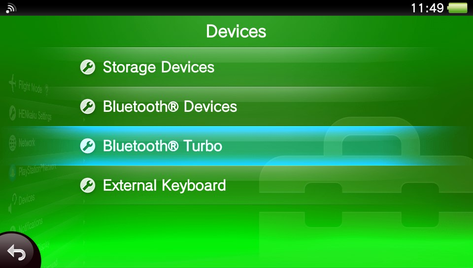 | 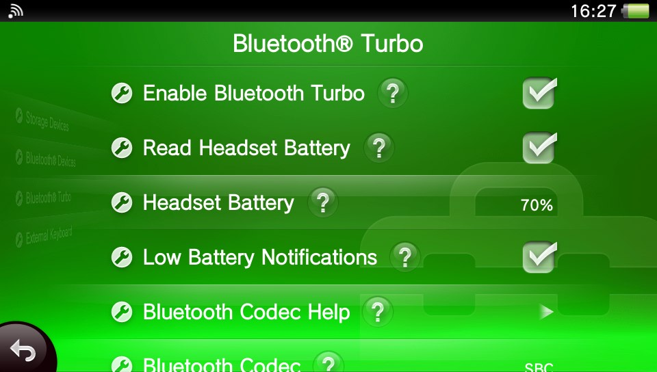 |

| Codecs and connection | Music Source Only and sound |
|---|---|
|  | 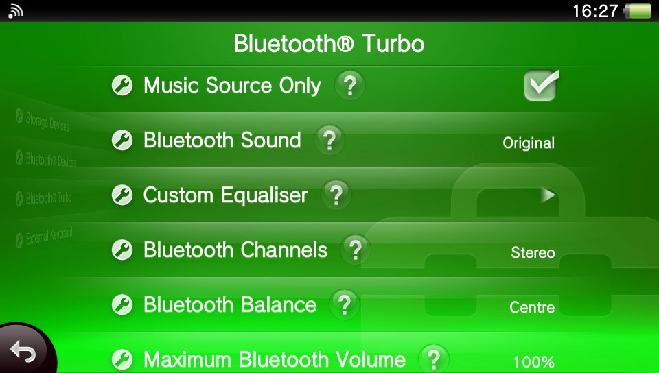 |

| And the rest | Bluetooth Codec Help |
|---|---|
| 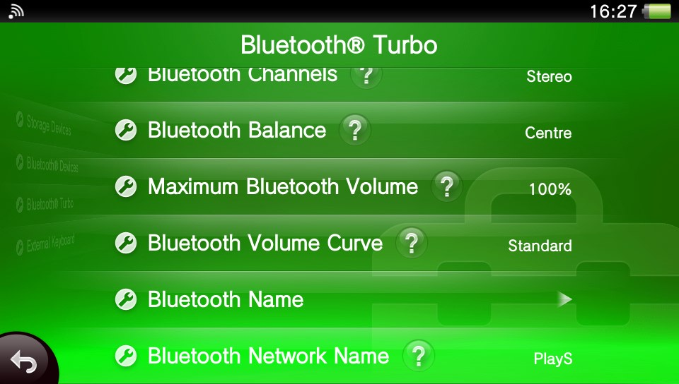 | 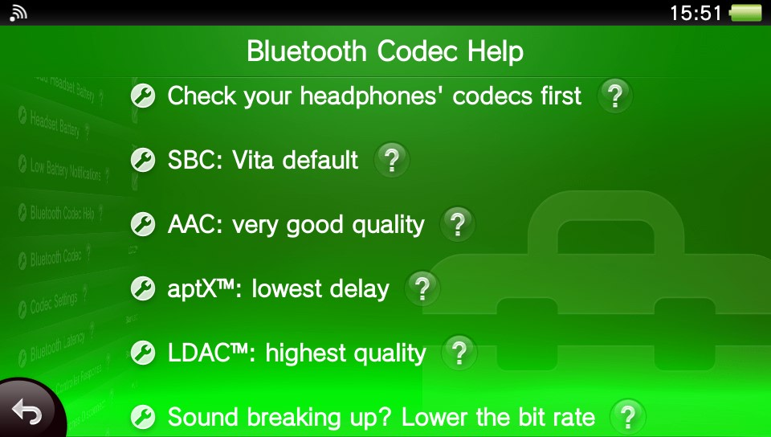 |

| Your headphones' page: codec in use | Headset Codecs, latency, battery and signal |
|---|---|
| 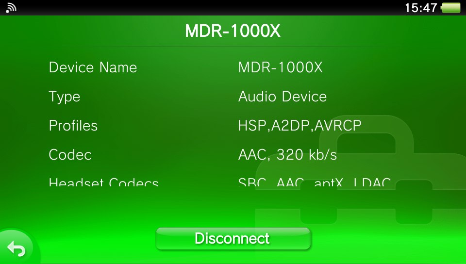 | 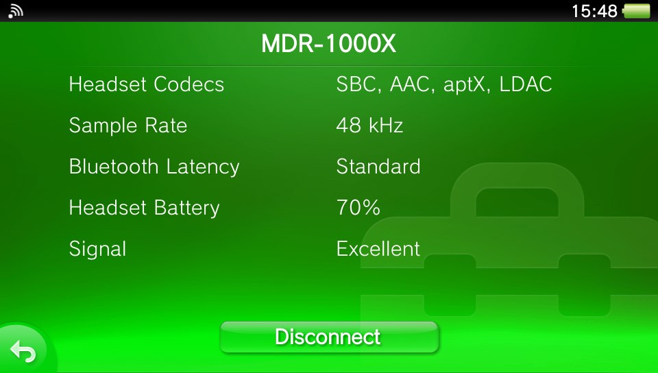 |

| SBC High: each ear separately | Custom Equaliser |
|---|---|
| 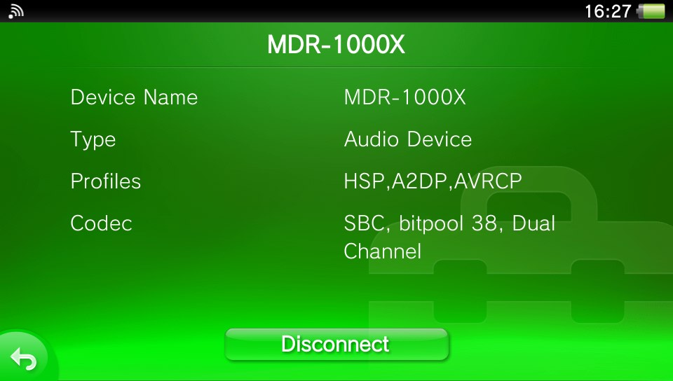 | 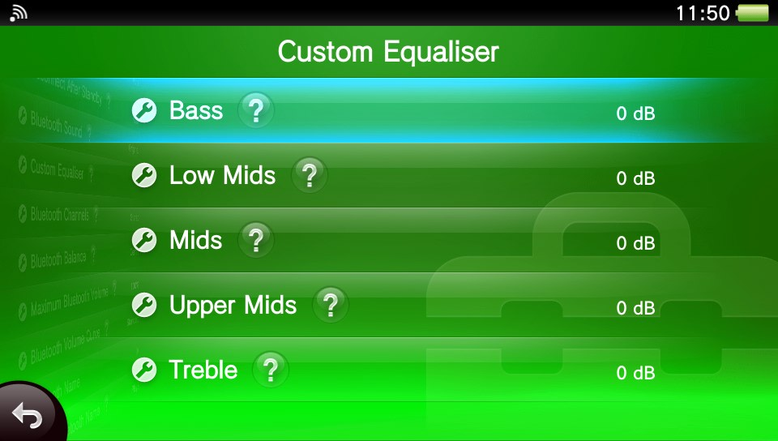 |

| Codec Settings (rows for other codecs greyed while SBC is chosen) | SBC Audio Quality |
|---|---|
| 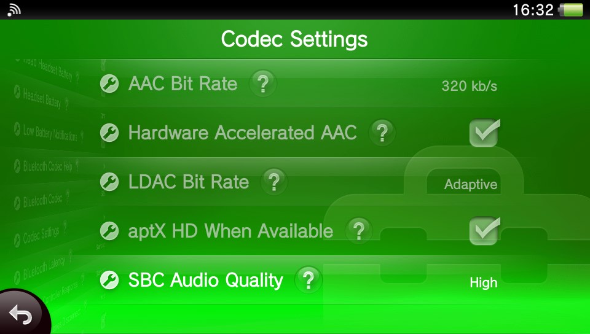 | 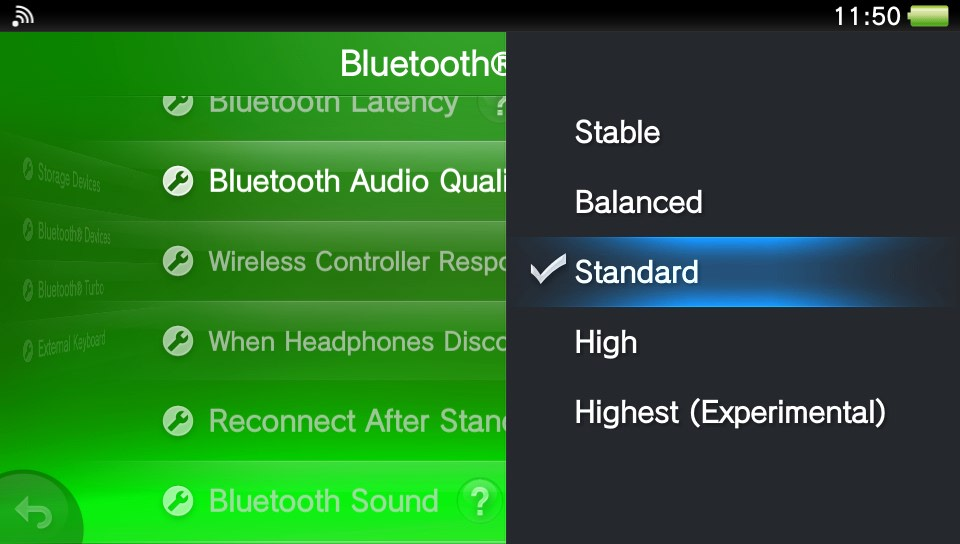 |

| Bluetooth Latency | Low battery notification, over a game |
|---|---|
| 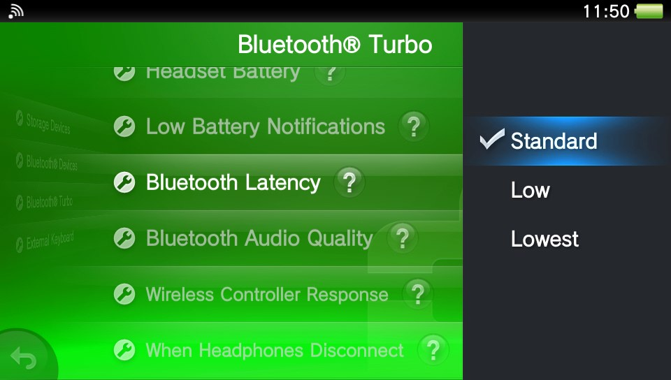 | 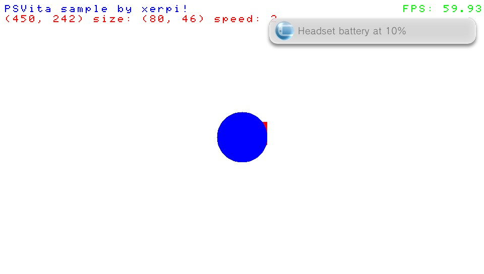 |

## Options

### Settings → Devices → Bluetooth Turbo

Every row has a **?** help text. (In English (UK) the console shows *Equaliser* and *Centre*.)

| Option | What it does | Default |
|---|---|---|
| **Enable Bluetooth Turbo** | Master switch. Off is the console's original behaviour, exactly: the timing fix, the battery reading, the latency, the codec and the audio quality, the controller response and the sound and volume changes are all taken out. Re-pair your devices with this turned on for maximum compatibility. | On |
| **Read Headset Battery** | Opens the hands-free connection that headsets use for their battery level and microphone. Off uses only the console's own headset connection: no level is read, so *Headset Battery* shows *Not Reported* and *Low Battery Notifications* has nothing to show. After changing it, remove the headset in Bluetooth Devices and pair it again. | On |
| **Headset Battery** | Read only. The battery level of the connected Bluetooth headset, as the headset reports it; *Not Reported* when it does not, *Not Connected* while no headset is connected. When headphones connect, Bluetooth Turbo opens the hands-free connection that headsets report their battery over, in place of the console's simpler headset connection. A headset paired before you installed and enabled Bluetooth Turbo has to be removed and paired again once. It is read when the page opens and shown again when you change *Read Headset Battery*; a new level from the headset only shows when you open the page again. | |
| **Low Battery Notifications** | A system notification when the battery of the connected headset falls to 20%, 10% and 5%, once for each drain; the text follows the console's language. Needs a headset that reports its battery; 5% needs one that reports in steps finer than 10%. Off sends none. Greyed out (and not changeable) while *Read Headset Battery* is off. | On |
| **Bluetooth Codec Help** | Read-only sub-page above *Bluetooth Codec*: six short lines, each with a *?*, on checking your headphones' codecs, what each codec is good for, and what to do if the sound breaks up. See [Choosing a codec](#choosing-a-codec). | |
| **Bluetooth Codec** | *SBC*, *AAC*, *aptX™* or *LDAC™*. The last three are optional add-ons (see *Install*), offered once installed and the start-up self-check has passed (about 45 seconds after start-up), and used only with headphones that support them; otherwise SBC. A change reconnects the headphones briefly ([details](#changes-that-reconnect-the-headphones); [notifications](#codec-notifications)). See [AAC](#aac), [aptX](#aptx), [LDAC](#ldac). | SBC |
| **Codec Settings** | Sub-page under *Bluetooth Codec* with the next five rows, in this order, each shown only with its module. *Bluetooth Latency* stays on the main page because it applies to every codec. Changes apply at once, with a brief reconnect (not *LDAC Bit Rate*). The *?* of each row lists its choices. | |
| &emsp;**AAC Bit Rate** (in *Codec Settings*) | *128*, *192*, *256* or *320* kb/s, capped to what the headphones accept. Greyed unless *Bluetooth Codec* is *AAC*. See [AAC](#aac). | 256 |
| &emsp;**Hardware Accelerated AAC** (in *Codec Settings*) | Encodes AAC with the processor's vector instructions, which takes less processor time. Offered only when the start-up self-check shows it sounds exactly the same as the ordinary encoder; greyed unless AAC. | On, when its self-check passes |
| &emsp;**LDAC Bit Rate** (in *Codec Settings*) | *330 kb/s*, *660 kb/s* or *Adaptive* (experimental). 660 needs about twice the radio time of 330, so it may break up where Wi-Fi is busy or reception is poor. Greyed unless LDAC; applies to a playing stream at once. See [LDAC](#ldac). | 330 |
| &emsp;**aptX HD When Available** (in *Codec Settings*) | On: headphones that offer aptX HD get it (experimental, about 576 kb/s) instead of aptX. Off: standard aptX (about 384 kb/s). Shown once its aptX HD self-test has passed; greyed unless *aptX*. See [aptX](#aptx). | On |
| &emsp;**SBC Audio Quality** (in *Codec Settings*) | How the Vita encodes the sound whenever SBC is in use, also when another codec falls back to it: *Stable*, *Balanced*, *Standard*, *High* or *Highest (Experimental)*. Lower levels give better range and steadier sound at slightly less detail. Levels in the table below. | Standard |
| **Bluetooth Latency** | How many sound packets the Vita lets queue for the radio before it backs off. *Standard* is 23 (about 245 ms), *Low* 11 (about 117 ms), *Lowest* 7 (about 75 ms). Less lag when the radio is busy; where reception is poor or Wi-Fi is busy the sound may drop out for a moment instead, and *Lowest* does so sooner. *Lowest* also makes the radio drop a sound packet that has waited about 50 ms instead of resending it late, so on a poor connection you may hear brief gaps; at *Standard* or *Low*, or with the master switch off, it is no longer used (a timeout already set on a playing stream ends when that stream stops). | Standard |
| **Wireless Controller Response** | *Fast* stops the Vita putting the controllers it knows into their power-saving mode, so their input waits less. It uses more controller battery and applies from the next time a controller connects. | Standard |
| **When Headphones Disconnect** | What the console does when Bluetooth headphones switch off or lose their connection. *Mute* is the console's own. *Pause, Keep Volume* pauses the music and does not mute. *Play on Speaker* does not mute and keeps playing, on the speaker. Applies from the next time headphones disconnect. | Mute |
| **Reconnect After Standby** | When the console wakes from standby it connects the headphones it last played sound on: once Bluetooth is up again plus 3 seconds, if they have no connection, at most twice. It learns the headphones the next time sound starts on them. Headphones also paired with a phone may connect to the phone instead. | Off |
| **Music Source Only** | On: the console only offers to send sound, so two-way devices such as smart speakers connect the right way round. Off: the console's own list, which also offers its speaker role. It applies from the next time a device connects; remove the device and pair it again after changing it. | On |
| **Bluetooth Sound** | *Original*, *Warm*, *Bright*, *Bass Boost*, *Lively* or *Custom*. The console's processor does the filtering, at a very small cost in battery (about 1 mA, see below). *Original* leaves the sound untouched. | Original |
| **Custom Equalizer** | *Bass*, *Low Mids*, *Mids*, *Upper Mids* and *Treble*, from -12 to +12 dB, used when *Bluetooth Sound* is *Custom*. | 0 dB each |
| **Bluetooth Channels** | *Stereo*, *Mono* (the two sides averaged, on both) or *Swap Left and Right*. Only the sound sent to Bluetooth headphones changes. | Stereo |
| **Bluetooth Balance** | Nine steps, *L4* to *R4*: the other side is lowered by 3, 6 and 12 dB for steps 1 to 3 and silenced at step 4. | Center |
| **Maximum Bluetooth Volume** | The highest volume the Vita will set on the headphones: 100%, 90%, 80%, 70%, 60% or 50% of their full volume. Like the curve, it only affects headphones that take their volume from the Vita. | 100% |
| **Bluetooth Volume Curve** | How the Vita's 31 volume steps are sent to the headphones: *Standard*, *Finer at Low Volume* (quieter, closer low steps) or *Louder at Low Volume*. Only headphones that take their volume from the Vita are affected, and the new setting is heard from the next volume change. | Standard |
| **Bluetooth Name** | The name other devices see when they look for the console over Bluetooth: up to 16 letters, digits and symbols (no accents). Empty is *PlayStation Vita*. It applies the next time Bluetooth is switched on, so turn Bluetooth off and on; a device that already knows the console may keep the old name. A name the console refuses may stay in the text field until the page is opened again. | PlayStation Vita |
| **Bluetooth Network Name** | Read only: the name the console uses now, as set under *Bluetooth Name*. It updates the next time the page is opened. | |

The settings are separate from any other Turbo plugin's.

*SBC Audio Quality* levels (the most each uses, at 48 kHz):

| Level | What it does | Bit rate |
|---|---|---|
| *Stable* | joint stereo, bitpool capped at 37 | about 260 kb/s |
| *Balanced* | joint stereo, bitpool capped at 45 | about 310 kb/s |
| *Standard* | the Vita's default profile: joint stereo at the headphones' highest bitpool | up to about 357 kb/s |
| *High* | each ear separately, bitpool capped at 38 | about 490 kb/s |
| *Highest (Experimental)* | each ear separately at the headphones' highest bitpool (53 for the usual headphones, 59 at most), larger packets; some headphones play no sound at all, so switch back if so | about 670–740 kb/s, depending on the headphones |

<details>
<summary>More detail: the limits of the levels</summary>

The headphones' own limits are never exceeded and their own minimum is never undercut. Headphones that cannot encode each ear separately stay on joint stereo at *High* and *Highest*. The *?* help text of the row has one *Level = bit rate* line for each level, in the order of the table, then a short paragraph.

</details>

### Settings → Devices → Bluetooth Devices → (your headphones)

Bluetooth Turbo adds rows to the console's own page for one Bluetooth device. They appear **only on the page of the headphones that hold the
sound link now** (the ones the console is playing sound to, or has connected for sound); "that page" below means that one. On the page of any other
device, or when no headphones are connected, nothing is added. The values are read when the page is opened, so open it again to see new ones.

| Row | What it shows | When it appears |
|---|---|---|
| **Codec** | The codec in use and its figures: *AAC, 256 kb/s*, *aptX*, *aptX HD*, *LDAC, 660 kb/s* or *SBC, bitpool 53, Joint Stereo*. | On that page. |
| **Headset Codecs** | The codecs the headphones list, for example *SBC, AAC, aptX, aptX Adaptive (unsupported)*: the ones Bluetooth Turbo can use by name, *(add-on available)* for a codec whose add-on is not installed, *(unsupported)* for codecs the Vita cannot use, *Not Known Yet* when the list has not been read. | On that page. |
| **Refresh Codecs** | A button, right under *Headset Codecs*: the headphones reconnect briefly so the Vita can read their codecs. | Only while *Headset Codecs* says *Not Known Yet*. |
| **Sample Rate** | The rate of the sound sent, in kHz. | On that page. |
| **Bluetooth Latency** | The *Bluetooth Latency* setting in force (*Standard*, *Low* or *Lowest*). | On that page. |
| **Headset Battery** | The headset's battery in percent, or *Not Reported*. | On that page. |
| **Signal** | *Excellent*, *Good*, *Fair* or *Weak*, from the radio's own link quality and signal strength taken together; *Measuring…* for the few seconds after the headphones connect. | On that page. |
| **Profiles** (the console's own row, with an addition) | *A2DP,AVRCP,HFP*: Bluetooth Turbo adds *HFP* when it has opened the hands-free link for the battery and the microphone, or *HSP* when only the console's own headset link is up. | When the headphones holding the sound link have such a link; nothing is added otherwise. |

### Choosing a codec

Open the headphones' own page (*Settings → Devices → Bluetooth Devices*, then the headphones). *Headset Codecs* lists what they offer; if it says
*Not Known Yet*, press *Refresh Codecs* below it. Then follow the chart. Figures marked *measured* I took on my own Vita; *expected* ones I have not yet
measured; *calc* ones are calculated from the packet sizes.

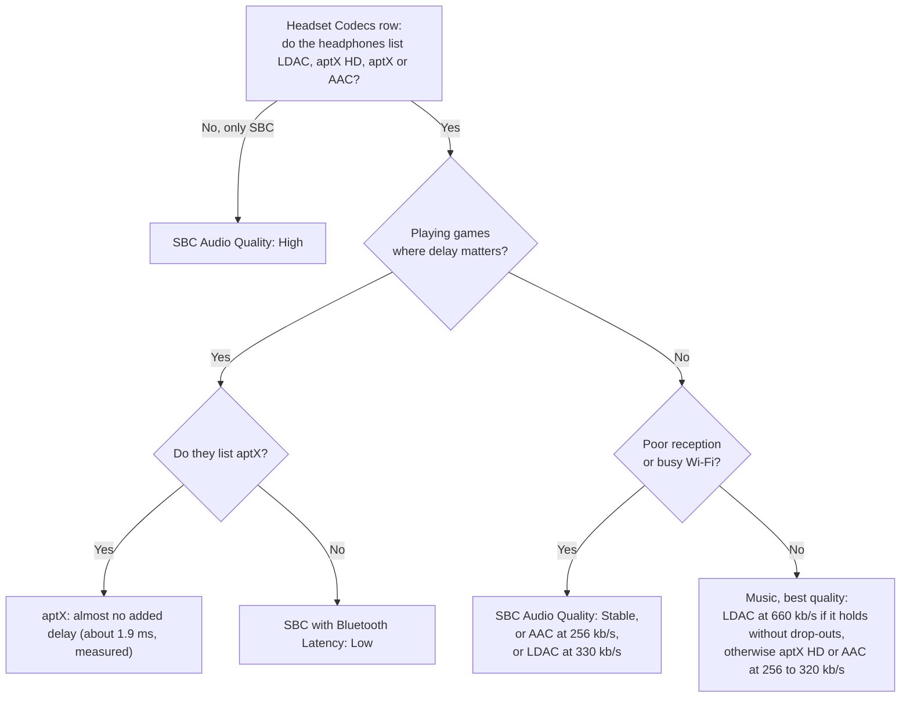

The same, as a list, for readers where the chart does not show:

1. Do the headphones list LDAC, aptX HD, aptX or AAC? If not (only SBC), use *SBC Audio Quality* *High*.
2. Playing games where delay matters? Use aptX if they list it (it adds almost no delay: about 1.9 ms, measured), otherwise SBC with *Bluetooth Latency* *Low*.
3. Poor reception or busy Wi-Fi? Use *SBC Audio Quality* *Stable*, or AAC at 256 kb/s, or LDAC at 330 kb/s.
4. Otherwise (music, best quality): LDAC at 660 kb/s if it holds without drop-outs, else aptX HD or AAC at 256 to 320 kb/s.

A codec the headphones do not list is never used. None of the codecs should slow your games down.

<details>
<summary>More detail: the codecs side by side, start-up and processor use</summary>

| Codec | Bit rate | Added delay | Radio time | Processor | Status |
|---|---|---|---|---|---|
| SBC (the console's own, joint stereo) | about 357 kb/s at 48 kHz (calc) | none beyond the send queue, which *Bluetooth Latency* sets: 245 ms *Standard*, 117 ms *Low*, 75 ms *Lowest* (the queue's limit, from 0.1.0, not a timing on air) | about 23 % (calc) | | the console's own |
| SBC, *High* / *Highest* (dual channel) | | not measured | about 35 % (calc), with packets of up to about 909 bytes | | |
| AAC | 256 kb/s by default, up to 320, never above what the headphones accept (my headset: 265, measured) | about 55 ms: 33 ms of encoder delay (measured) plus one 21.3 ms frame | not measured | 3.3 ms per 21.3 ms frame with *Hardware Accelerated AAC*, 4.4 ms without (measured at 444 MHz, same test) | 0 gaps in 4,131 frames (measured) |
| aptX™ | 384 kb/s at 48 kHz (fixed) | about 1.9 ms (measured, through the encoder and a reference decoder on a computer) | not measured | about 2.2 ms per 10.7 ms block, about 20 % of the system core (measured) | played on one pair of headphones, 0 failed blocks (measured) |
| aptX HD | 576 kb/s (fixed) | not measured | not measured | not measured | experimental and untested |
| LDAC™ | 330 kb/s (the default), 660 kb/s or *Adaptive* between 330 and 660 | about 8 to 19 ms (expected) | about 23 % at 330 kb/s, about 47 % at 660 kb/s (calc); 990 kb/s is not offered (about 70 %) | about 14 % of the system core (measured) | played on one pair of LDAC headphones at 330 kb/s, 660 kb/s and *Adaptive* (experimental), 660 kb/s also with Wi-Fi busy uploading, 0 failed packets (measured) |

Radio time is the share of the radio the sound takes: the more a codec takes, the sooner it breaks up where Wi-Fi is busy or reception is poor.
Delay matters for games and video, not for music alone.

AAC and LDAC encode in threads of their own, pinned to the system core (the core the console keeps for itself, not the ones games run on), at a priority just below the console's own audio thread. aptX and aptX HD encode inside the console's own audio sender thread, which the console itself pins to that same system core; that is also where its built-in SBC encoder runs.

Headphones that connect at power-on start on SBC and switch to your codec by themselves once it is ready, with a short pause. An add-on codec is sent whichever side connects the headphones. If headphones stay silent after you go back to SBC, remove them in Bluetooth Devices and pair them again.

</details>

### Cost of the sound filter

The filter runs on the Vita's processor, five bands on each channel, once per block of sound (every
10.67 ms). My estimate is about 2 to 3 % of one core while sound plays through Bluetooth headphones and a
preset is on; its battery cost came out at about 1 mA (see below). With *Original*, nothing is filtered. Where a
preset or a custom band boosts, the overall level is lowered to match so the sound doesn't distort, so the
result can come out slightly quieter than *Original*.

### Battery drain

I measured the console's battery current for each setting: my PS Vita 1000 on 3.60, unplugged, screen dimmed,
music playing to one headset, Wi-Fi connected and idle, 60 seconds a step. Each step is compared with Bluetooth
Turbo switched off at the same battery voltage.

| Setting | Change in current |
|---|---|
| On, at the defaults | −0.1 mA (0.0 %) |
| *Bluetooth Latency* *Low* / *Lowest* | −0.1 / 0.0 mA (0.0 %) |
| *Bluetooth Sound* *Warm* / *Custom* | +1.1 / +0.8 mA (+0.3 % / +0.2 %) |
| *SBC Audio Quality* *Stable* / *Balanced* | −0.3 / −0.6 mA (−0.1 % / −0.2 %) |
| *SBC Audio Quality* *High* / *Highest* | +0.6 / +0.4 mA (+0.2 % / +0.1 %) |

The console draws about 360 mA in this state, and the readings within a step spread by about ±2 mA, so none of
these costs measurable battery; the sound filter is the only one that comes out consistently above, by about 1 mA. The
headset battery reading and *Wireless Controller Response* weren't part of this run.

**The codecs cost about 1 % more.** A second run measured the codecs the same way (the same console, screen dimmed, music
playing to one headset, 60 seconds a step, each step compared with Bluetooth Turbo switched off, which drew
366.5 mA there; a final reading of SBC again came out +1.0 mA higher, so read the figures as accurate to about a milliampere):

| Codec | Change in current |
|---|---|
| SBC (the console's own codec, Bluetooth Turbo on) | −0.5 mA (−0.1 %) |
| AAC, *Hardware Accelerated AAC* on | +2.5 mA (+0.7 %) |
| AAC, *Hardware Accelerated AAC* off (the ordinary encoder) | +3.7 mA (+1.0 %) |
| LDAC, adaptive (about 396 kb/s) | +4.1 mA (+1.1 %) |
| aptX | +4.6 mA (+1.3 %) |

Encoding takes processor time, so the three codecs cost a little: about 1 % of what the console draws, which is
roughly 2 to 5 mA.

### AAC

Good, steady quality, common on earbuds made for phones. An optional add-on (`bluetoothturbo_aac.skprx`, a separate download, see *Install*), used only with headphones that offer AAC; else SBC.

| | |
|---|---|
| Bit rate | *128*, *192*, *256* (default) or *320* kb/s; never above what the headphones accept (my headset: 265, measured) |
| Added delay | about 55 ms (33 ms encoder delay plus one 21.3 ms frame): suits *Standard* latency, not games |
| Encode time | 3.3 ms per 21.3 ms frame with *Hardware Accelerated AAC*, 4.4 ms without (hardest signal, 444 MHz) |
| Memory | about 48 KB, none from the Home screen or games |
| Tested | 0 gaps in 4,131 frames; all measured on my PS Vita 1000 (3.60) |
| Licence | [THIRD_PARTY_NOTICES.md](THIRD_PARTY_NOTICES.md) |

<details>
<summary>More detail: encode times and how it runs</summary>

Without the module the Settings page offers SBC only and its hint says where to get the module. Bluetooth Turbo encodes AAC with an open-source AAC
encoder that runs inside its own kernel module, on the core the Vita keeps for the system, so it takes no memory from
the Home screen or from games. Its thread is pinned to that core and runs at a priority just below the console's own audio thread, so it should not affect games. I measured it on my PS Vita 1000 (3.60) against the Vita's own AAC encoder (the one its
Camera app uses), with 10 seconds of each test signal, as the time to encode one AAC frame (1024 samples, 21.3 ms of
sound) at 256 kb/s:

| Signal | Bluetooth Turbo's encoder | The same, with vector instructions | The Vita's own encoder |
|---|---|---|---|
| Tone | 2.0 ms average (4.2 ms at worst) | 1.4 ms (3.0 ms) | 3.5 ms (5.3 ms) |
| Sweep | 2.0 ms (3.4 ms) | 1.4 ms (2.9 ms) | 3.3 ms (4.1 ms) |
| Noise (the hardest to encode) | 4.4 ms (6.5 ms) | 3.3 ms (4.8 ms) | 5.5 ms (6.6 ms) |
| Noise, processor at 333 MHz | 5.9 ms (8.4 ms) | 4.5 ms (6.3 ms) | 7.4 ms (8.8 ms) |

Even the hardest signal takes about a fifth of a frame's time, so the encoder keeps up with room to spare. AAC works in larger
blocks than SBC, and it keeps the full 20 kHz of the sound. It is sent at the *AAC Bit Rate* you set (256 kb/s by default, or the highest rate the
headphones accept if that is lower). The table's "vector instructions" column is *Hardware Accelerated AAC*.

</details>

### aptX

Lowest delay, best for games. An optional add-on (`bluetoothturbo_aptx.skprx`, a separate download, see *Install*), used only with headphones that offer aptX; else SBC.

| | |
|---|---|
| Bit rate | about 384 kb/s at 48 kHz, fixed (no setting) |
| Added delay | about 1.9 ms (measured, through the encoder and a reference decoder on a computer) |
| Encode time | about 2.2 ms per 10.7 ms block, about 20 % of the system core (measured) |
| Memory | none from the Home screen or games |
| Tested | one pair of headphones, 0 failed blocks (measured) |
| aptX HD (experimental) | about 576 kb/s, used instead of aptX with headphones that offer it while *aptX HD When Available* is on (default); untested with real headphones |
| Licence | [THIRD_PARTY_NOTICES.md](THIRD_PARTY_NOTICES.md), `third_party/aptxenc/` |

<details>
<summary>More detail: aptX HD, fallback and licence</summary>

The module is offered only once its start-up self-check has passed. Without the module the Settings page's hint says where to get it. It runs inside the kernel module like the AAC
encoder. Turn *aptX HD When Available* (in *Codec Settings*) off to keep plain aptX (headphones that connect to the console themselves get
aptX). aptX HD sends 6 bytes for every 4 frames of sound in packets with a small header, sized to
what the headphones accept. If a headphone set rejects it or
it fails, aptX HD is switched off until the next start-up and the headphones keep plain aptX.

</details>

### LDAC

Highest quality, needs a strong signal; experimental. An optional add-on (`bluetoothturbo_ldac.skprx`, a separate download, see *Install*), used only with headphones that offer LDAC at 48 kHz in stereo; else SBC.

| | |
|---|---|
| Bit rate | *330 kb/s* (default), *660 kb/s* or *Adaptive* (between the two; experimental) |
| Added delay | about 8 to 19 ms (expected) |
| Radio time | about 23 % at 330 kb/s, about 47 % at 660 kb/s (calc) |
| Encode time | about 14 % of the system core (measured) |
| Memory | about 23 KB while LDAC plays, none from the Home screen or games |
| Tested | one pair of LDAC headphones at 330, 660 kb/s and *Adaptive* (also 660 with Wi-Fi busy uploading), 0 failed packets (measured); no others |
| Licence | [THIRD_PARTY_NOTICES.md](THIRD_PARTY_NOTICES.md), `third_party/libldac/` |

<details>
<summary>More detail: packet size, bit rates and licence</summary>

The module is offered only once its start-up self-check has passed. The encoder is Sony's open-source LDAC encoder. It runs in a thread of its own on the system core and encodes in fixed point. LDAC packets are built to fill one long radio
packet (about 673 bytes), so the console allows the long packet types while LDAC is chosen, and LDAC needs headphones whose media channel accepts at least 679 bytes: if they do
not, LDAC ends before any sound and those headphones are offered SBC until the next start-up. 990 kb/s is not offered: it would need about 70 % of the radio's time.

</details>

### Changes that reconnect the headphones

- *Bluetooth Codec*, *AAC Bit Rate*, *Hardware Accelerated AAC*, *aptX HD When Available* and *SBC Audio Quality* are fixed when the headphones connect, so a change reconnects them once, about 1.5 seconds after your last change, with a short gap in the sound.
- *LDAC Bit Rate* never reconnects: it goes to a playing stream at once.
- No reconnect while a microphone is in use, with Bluetooth Turbo off, or when the change makes no difference; it then applies the next time they connect.
- Everything else applies at once, except *Bluetooth Name*, *Read Headset Battery* and *Wireless Controller Response*, which keep their own rules above.

<details>
<summary>More detail: when it does not reconnect</summary>

Scrolling through a list reconnects once, and putting a list back where it was does nothing. No difference means a bit rate while the headphones are on SBC, a quality while they are on AAC, aptX or LDAC, *aptX HD When Available* while they are not on aptX or when they already get what it gives, or a rate they already get. If the
reconnect fails, the headphones stay as they are and you switch them off and on as before.

</details>

### Codec notifications

When you chose AAC, aptX or LDAC and a connection uses SBC instead, a system notification says why, in the console's language (shown here for AAC):

- *Your headphones don't support AAC. Using SBC.* The headphones' codec list is known and does not hold the codec.
- *Your headphones couldn't use AAC. Using SBC.* They rejected the codec, or the stream never started. They are then not offered that codec again until the console restarts.

Each headset and codec is told once until the console restarts; changing *Bluetooth Codec* starts again. The Home screen module (the `*main` line under *Install*) shows them; without it nothing is shown, and the codec still falls back to SBC.

<details>
<summary>More detail: when a notice is shown and when it is not</summary>

The codec list is known once the console has opened a stream to the headphones, or after *Refresh Codecs* on their page; a headset that has only ever connected itself may show *Not Known Yet*, and then nothing is said. The second notice also covers headphones that rejected the start of the stream until the console gave up asking. aptX HD that was refused is named *aptX HD*; the next connection of those headphones uses plain aptX, so no notice is shown when it breaks after it started.

A headset that has refused a codec is not offered that codec again until the console restarts; the other codecs it lists are still offered, and each is told on its own.
If the console's own codec module could not start a session for a headset (the headphones did nothing wrong), the headset is likewise not offered that codec again until the console restarts, so the sound cannot fall silent in a loop of reconnects, but no notice is shown and a later *Bluetooth Codec* change is not blamed on the headphones.

</details>

## Supported consoles

- **PS Vita 1000, PS Vita 2000 and PS TV:** Bluetooth Turbo touches only the Bluetooth code, which is the
  same on every model, so it is expected to work on all of them. Running on my PS Vita 1000 (3.60); I have not tested the others yet.
- Bluetooth Turbo checks the code it changes byte for byte before it writes anything. If a console's code
  isn't what it was checked against (another firmware, or another plugin that has patched it), it changes
  nothing and the log says why.

Firmware 3.60 to 3.74 with HENkaku/taiHEN (Ensō, h-encore, etc.); the Bluetooth code is identical on all
of them. Tested on 3.60 so far.

## If your headphones keep disconnecting

Bluetooth Turbo writes one line to its log (`ur0:data/bluetoothturbo/bluetoothturbo_kernel.log`) for each Bluetooth link that comes up, fails
to come up, or ends: who opened it (the Vita or the device), the profiles that opened and the reason the link ended, in words and as the
controller's code, for example `ended after 41.2 s: remote user terminated (0x13)` or `connection timeout (0x08)`. Only the first three bytes of the
device's address are written. A device that keeps reconnecting the same way becomes one line and a count, so the log cannot fill up.
If you report a problem, the lines about your headphones from that file are the most useful thing to include. It only watches; it changes nothing.

For a speaker that connects but plays nothing, the lines that start with `music source only:` say whether the device tried to use the console as a speaker
(`refused`) and how many times the console answered with its music source only.

## Languages

The Settings page follows your system language. Supported:

Japanese, English (US), English (UK), French, Spanish, German, Italian, Dutch,
Portuguese (Portugal), Portuguese (Brazil), Russian, Korean,
Chinese (Traditional), Chinese (Simplified), Finnish, Swedish, Danish,
Norwegian, Polish and Turkish.

English is the reference. The other 19 languages are machine translations; corrections from native
speakers are very welcome.

## Disclaimer

This software is provided **"as is", without warranty of any kind**, express or
implied, including but not limited to the warranties of merchantability,
fitness for a particular purpose and non-infringement. It modifies how system
software on your console behaves. **You use it entirely at your own risk.** The
author is not responsible for any damage, data loss, bricked or unusable
systems, lost warranty, or any other harm resulting from installing or using
it. Keep backups, and make sure you know how to boot without plugins (hold
**L** at boot) before you install. See the [MIT License](LICENSE) for the full
terms.

Bluetooth Turbo is an unofficial project, not affiliated with or endorsed by Sony
Interactive Entertainment, or with the Bluetooth Special Interest Group.
PlayStation and PS Vita are trademarks of their respective owners. The
Bluetooth® word mark is a registered trademark owned by Bluetooth SIG, Inc.
aptX is a trademark of Qualcomm Technologies, Inc.; this project is not affiliated with or endorsed by it, and names aptX only to
say which codec it is compatible with.
LDAC is a trademark of Sony Group Corporation; this project is not affiliated with or endorsed by it, and names LDAC only to say which codec it is compatible with.

## Install

**Requirements:** a PS Vita with HENkaku or Ensō (taiHEN), on firmware **3.60 to
3.74**. Other versions are not supported.

1. Copy `bluetoothturbo_kernel.skprx`, `bluetoothturbo_settings.suprx` and
   `bluetoothturbo.suprx` to `ur0:tai/`, for example with VitaShell over FTP or USB. For AAC, also copy
   `bluetoothturbo_aac.skprx` (the optional AAC add-on) and for aptX also `bluetoothturbo_aptx.skprx` (the optional aptX
   add-on) and for LDAC also `bluetoothturbo_ldac.skprx` (the optional LDAC add-on); each is a separate download from the release page.
2. **Find your config file.** If `ux0:tai/config.txt` exists, edit **that**
   one: taiHEN reads it first and ignores `ur0:tai/config.txt`. Otherwise edit
   `ur0:tai/config.txt`. Keep the `ur0:tai/...` paths for the plugin files
   either way.

   Add one line under each of three sections, and a further line for each add-on you want (`make config` prints them):

   | Section | Line to add |
   |---|---|
   | `*KERNEL` | `ur0:tai/bluetoothturbo_kernel.skprx` |
   | `*KERNEL`, after the main module's line | `ur0:tai/bluetoothturbo_aac.skprx` (optional: the AAC add-on, a separate download. Adding this line is what turns AAC on as a choice; leave it out and *Bluetooth Codec* offers SBC only) |
   | `*KERNEL`, after the main module's line | `ur0:tai/bluetoothturbo_aptx.skprx` (optional: the aptX add-on, a separate download. Adding this line is what turns aptX on as a choice; leave it out and *Bluetooth Codec* does not offer aptX) |
   | `*KERNEL`, after the main module's line | `ur0:tai/bluetoothturbo_ldac.skprx` (optional: the LDAC add-on, a separate download. Adding this line is what turns LDAC on as a choice; leave it out and *Bluetooth Codec* offers no LDAC) |
   | `*main` | `ur0:tai/bluetoothturbo.suprx` (the low battery notifications and the codec notices; about 12 KB in the Home screen, one small thread. Optional: leave it out and you only lose the notifications) |
   | `*NPXS10015` | `ur0:tai/bluetoothturbo_settings.suprx` (adds the Settings page) |

   HENkaku's default config already has these sections, so add the lines under
   the existing ones. A typical file afterwards looks like this:

   ```
   *KERNEL
   ur0:tai/bluetoothturbo_kernel.skprx
   ur0:tai/bluetoothturbo_aac.skprx
   ur0:tai/bluetoothturbo_aptx.skprx
   ur0:tai/bluetoothturbo_ldac.skprx
   *main
   ur0:tai/henkaku.suprx
   ur0:tai/bluetoothturbo.suprx
   *NPXS10015
   ur0:tai/henkaku.suprx
   ur0:tai/bluetoothturbo_settings.suprx
   *NPXS10016
   ur0:tai/henkaku.suprx
   ```

3. **Reboot the Vita** (a "Refresh taiHEN config" from HENkaku Settings is not
   enough). Then open *Settings → Devices → Bluetooth Turbo*.

**To update:** replace the files and reboot. **To uninstall:** remove the lines
from `config.txt`, reboot, then delete the plugin files (three, plus one for each add-on) and `ur0:data/bluetoothturbo/`.
Settings are kept in `ur0:data/bluetoothturbo/`, and nothing else on the console is
changed.

### If the Bluetooth Turbo page doesn't appear in Settings

1. **With YAMT installed, put its line last** under `*NPXS10015`. YAMT replaces the whole Devices page, so a page added
   before its line is lost; `ur0:tai/bluetoothturbo_settings.suprx` goes first, then YAMT's line.
2. Check that `ur0:tai/bluetoothturbo_settings.suprx` exists with exactly that name, and that its line is under
   `*NPXS10015` in the same `config.txt` as the kernel module's line: `ux0:tai/config.txt` if it exists, otherwise
   `ur0:tai/config.txt`.
3. Reboot (refreshing the config from HENkaku Settings is not enough).
4. If it still doesn't appear, send me the kernel log (`ur0:data/bluetoothturbo/bluetoothturbo_kernel.log`) in an
   [issue](https://github.com/juanjsebgarcia/vita-turbo-bluetooth/issues).

## Build

```sh
make                       # uses $VITASDK if set, otherwise a pinned VitaSDK Docker image
make deploy VITA_IP=...    # upload to ur0:tai/ via vitacompanion, then reboot
make log VITA_IP=...       # fetch ur0:data/bluetoothturbo/bluetoothturbo_kernel.log
make config                # print the config.txt lines
make test                  # host tests and checks (needs a C compiler and Python 3)
```

Output: `build/bluetoothturbo_kernel.skprx`, `build/bluetoothturbo_settings.suprx`
(the Settings page), `build/bluetoothturbo.suprx` (the low battery and codec notifications) and
`build/bluetoothturbo_aac.skprx`, `build/bluetoothturbo_aptx.skprx` and `build/bluetoothturbo_ldac.skprx` (the optional AAC, aptX and LDAC add-ons).

Translations live in `tools/gen_i18n.py`. Edit the strings there, then run
`python3 tools/gen_i18n.py settings_app user kernel`.

## Safety

This plugin changes how the Bluetooth code behaves, so it's built to fail safe:

- **Memory only.** Every change lives in memory and is put back when you switch it off. Nothing is written to
  the console's system storage, and a reboot without the plugin restores everything.
- **Easy undo.** *Enable Bluetooth Turbo* off puts the console's own behaviour back at once. Every setting at its
  default is the console's own, except *Music Source Only*, which is on and leaves the console's speaker role out of what it offers (off is
  the console's own), and *Read Headset Battery* off goes back to the console's own headset
  connection.
- **Checked patches.** Each change is compared byte for byte with the code it expects first, and refuses to
  apply on a mismatch, such as another plugin's change. A feature whose check fails logs why and turns itself off.
- **Hands off during start-up.** Two small values go in about 12 seconds after start-up, so headphones that
  reconnect at power-on play from the start; everything else waits until the Home screen has been up for about
  45 seconds. The self-checks of the AAC, aptX and LDAC modules start at about 12 seconds too: each runs its own encoder on
  test data and touches nothing of the console's Bluetooth or sound. If a start didn't reach the Home screen, the next one runs
  without Bluetooth Turbo.
- **Only the Bluetooth side.** It never touches the audio chip, the sound driver, the wired volume tables or any
  other plugin's files and settings, and runs beside the other Turbo plugins and plugins that add rows to the
  same Settings page (tested with YAMT).
- **Escape hatch.** Holding **L** at boot skips every plugin.

## Contributing

Bug reports, translations and code are welcome. See
[CONTRIBUTING.md](CONTRIBUTING.md).

## Credits

Built on [taiHEN](https://github.com/yifanlu/taiHEN) and
[VitaSDK](https://vitasdk.org), with
[vitacompanion](https://github.com/devnoname120/vitacompanion)
([my fork](https://github.com/juanjsebgarcia/vitacompanion)) for installing
test builds. Thanks to the PS Vita homebrew community.

## License

[MIT](LICENSE) © 2026 Juan Garcia Alvite
