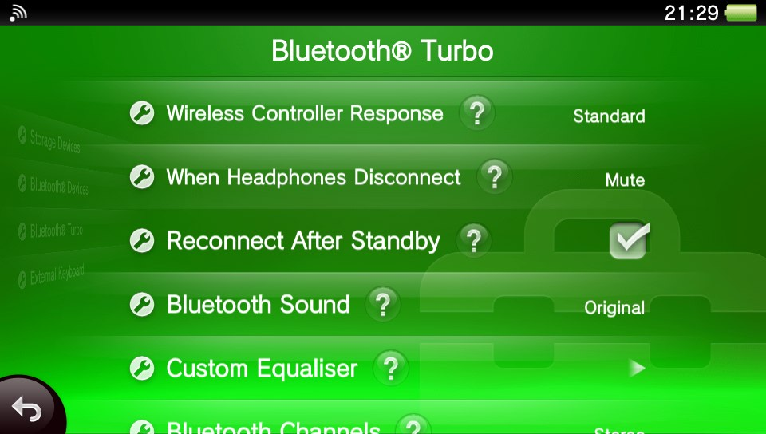

<div align="center">

# 🎧 Bluetooth Turbo for PS Vita

**The PS Vita's Bluetooth sound, fixed: it works with modern earbuds, lags less, sounds the way you like, and shows your headset's battery.**

A taiHEN plugin (kernel, Settings and Home screen modules) for HENkaku/Ensō on firmware 3.60 to 3.74.


</div>

> [!IMPORTANT]
> **Firmware 3.60 to 3.74.** Tested on one console, a PS Vita 1000 at 3.60, with
> two headsets; the other versions use the same Bluetooth code but haven't been
> tested on one yet. Other firmware versions are not supported: don't install it
> there. If something doesn't work, please
> [open an issue](https://github.com/juanjsebgarcia/vita-turbo-bluetooth/issues)
> with your logs.

> [!IMPORTANT]
> **A headset that was paired before you installed and enabled Bluetooth Turbo has to be removed
> from Settings → Devices → Bluetooth Devices and paired again once, so that it sees
> the new connection.** Without that, it won't report its battery level, and a headset
> that offers only hands-free won't give the Vita its microphone.

---

## Why

The Vita's Bluetooth sound has some rough edges. Most modern earbuds stay silent because each packet of
sound carries a timestamp that advances in the wrong step. When the radio is busy (Wi-Fi in use, a crowded
room) the sound can lag well behind the picture, because the Vita lets a long queue build up before it
backs off. The Vita's own sound settings never reach Bluetooth headphones. The first volume step can be too
loud for some earbuds. Its wireless controllers are put into a power-saving mode that makes their input
wait. And it never shows how much battery your headset has left. Bluetooth Turbo changes only what the Vita
sends to Bluetooth headphones and how it connects to them and to wireless controllers, and puts everything back
when you switch it off.

## Headline figures

One PS Vita 1000 on 3.60 with one headset, so read these as what happened for me. Stock is the console's own
behaviour; Bluetooth Turbo is the setting named in the first column. The drop-out counts are lost sound
packets in 3-minute runs at the edge of range with the Wi-Fi busy uploading; the latency and polling figures
are the limits the console applies (the queue length and the polling interval), not timings measured on air.

| | Stock | Bluetooth Turbo | Change |
|---|---|---|---|
| Packet timestamp step | 8000 (most modern earbuds stay silent) | **512** (they play) | **fixed** |
| Headset battery | not shown | **shown** | |
| Sound queue before the Vita backs off (*Lowest*) | ~245 ms | **~75 ms** | **−69 %** |
| Controller polling delay (*Fast*) | up to 11.25 ms | **none** | **−100 %** |
| Drop-outs at the edge of range, Wi-Fi busy (*Stable*) | up to about 4300 a minute (about 290 in another run) | **0** | **−100 %** |

*Standard* lost about 290 and 4300 packets a minute in two runs; *Stable* lost none in the run between them.
At a normal distance *Standard* was clean.

## Features

- ✅ **Timing fix.** Corrects the packet timestamp, so earbuds that stayed silent can play. On whenever
  Bluetooth Turbo is on, and left alone if another plugin has already made the same change.
- 🔋 **Battery read from headset.** When headphones connect, Bluetooth Turbo opens the hands-free connection
  that headsets report their battery over (the console normally opens only the simpler headset connection), and
  shows the level on its Settings page. Headsets that don't report one show *Not Reported*.
- 🎙️ **Headset microphones on newer headsets.** Newer headsets that use the hands-free protocol can now use their
  microphone on the Vita, for voice chat and anything else that records. Before, the Vita only took the microphone
  of older headsets. (Tick *Prioritise Bluetooth® Device Microphone* on the Vita's Bluetooth Devices page.)
- 🪫 **Low headset battery notifications.** A system notification when your headset's battery falls to 20%, 10% and 5%,
  once for each drain (a notification again after the battery has risen above a level or the headset has
  reconnected), in the console's language. They can be switched off in the Settings page. A headset that
  reports in steps of 10% gives the 20% and 10% notices only; the 5% notice needs a headset that reports finer.
- ⏱️ **Bluetooth latency.** *Standard*, *Low* or *Lowest*: a shorter send queue, so lag can't build up as
  far when the radio is busy. *Lowest* also drops sound that is already too late to be resent.
- 📶 **Bluetooth audio quality.** *Stable*, *Balanced*, *Standard*, *High* or *Highest (Experimental)*:
  *Stable* and *Balanced* send the sound at a lower bit rate that needs less radio time, so it holds on where
  reception is poor or Wi-Fi is busy; *High* and *Highest* send each ear separately at a higher one.
- 🎚️ **Bluetooth Sound.** Presets (*Warm*, *Bright*, *Bass Boost*, *Lively*) or your own five-band
  equaliser, applied to the sound on its way to the headphones.
- 🔀 **Channels and balance.** *Mono*, *Swap Left and Right*, and a nine-step balance from L4 to R4, for one
  earbud, hearing in one ear, or earbuds worn the wrong way round.
- 🔊 **Volume curve and maximum.** Finer or louder low steps, and a cap from 100 % down to 50 %, for
  headphones that take their volume from the Vita.
- 🎮 **Wireless controller response.** *Fast* stops the Vita putting the controllers it knows into their
  power-saving mode, so their input waits less, at the cost of controller battery.
- 🔌 **When headphones disconnect.** *Mute* is the console's own: it mutes itself when Bluetooth headphones
  go away. *Pause, Keep Volume* pauses the music without muting, and *Play on Speaker* does not mute and keeps
  playing, on the speaker.
- 💤 **Reconnect after standby.** Off by default. After the console wakes from standby it connects the
  headphones it last played sound on, so you don't have to switch them off and on.
- 🏷️ **Custom Bluetooth name.** Up to 16 letters, digits and symbols, so you can tell two consoles apart. Empty is
  *PlayStation Vita*.
- 📡 **Wi-Fi and Bluetooth side by side.** The Bluetooth link deliberately stays off the radio channels the Vita's own
  Wi-Fi is using, so the two never overlap and interference between them is kept to a minimum: headphones keep
  playing while the Wi-Fi is busy. It pairs nicely with Wi-Fi Turbo: with both enabled, the Bluetooth link stays clear
  of its whole 40 MHz channel.
- 🌍 **All 20 system languages.**
- 🛡️ **Safe by design.** Start-up is left alone (two small changes go in after about 12 seconds, everything
  else after 45), every change is checked against the code it changes first, and the original behaviour is one switch away.

## Use cases

### 🎮 Earbuds that stay silent
If your earbuds connect but play nothing, the timing fix is the thing to try. It is on by default.

### 🔋 How much battery is left?
With the headphones connected, open *Settings → Devices → Bluetooth Turbo*: *Headset Battery* shows the level
the headset reports. It is read when the page opens, so open the page again to refresh it. A headset
that doesn't report a level shows *Not Reported*. When the battery runs low, a notification tells you at 20%, 10% and 5%
(*Low Battery Notifications* switches that off). This works because, when headphones connect, Bluetooth Turbo
opens the hands-free connection that headsets report their battery over; the console normally opens only the
simpler headset connection. **A headset that was paired before you installed and enabled Bluetooth Turbo has to be removed
from Settings → Devices → Bluetooth Devices and paired again once, so that it sees the new connection.** A
headset that offers only the hands-free connection may not report its level straight after pairing: switch it
off and on once and it will. *Read Headset Battery* switches
that hands-free connection on or off; after changing it, remove the headset in Bluetooth Devices and pair it again.

**Headset microphones.** The headset's microphone works over the hands-free connection too, for headsets that offer
it. While the microphone is in use, the sound to the headset drops to call quality, as it does for any Bluetooth
headset on the Vita. *Read Headset Battery* Off goes back to the console's own headset connection. The Vita only
uses a Bluetooth headset's microphone when its own setting allows it: open *Settings → Devices → Bluetooth Devices*
and tick *Prioritise Bluetooth® Device Microphone* at the bottom of the page. I have recorded through the microphone of both
my headsets this way, one that offers only the hands-free connection and one that offers both.

### 🕹️ Games over Bluetooth
Set *Bluetooth Latency* to *Low* or *Lowest* to keep the lag from building up when the radio is busy. It is
*Standard* by default, because where reception is poor the sound may drop out for a moment instead of
lagging, and *Lowest* does so sooner: it keeps the queue shortest and lets the radio throw away a sound
packet that has waited about 50 ms instead of sending it late, so on a poor connection you may hear brief gaps.
I have tested it on one console with one headset, with the Wi-Fi busy uploading, and it played without gaps there.

### 📶 Sound drops out, or want more detail?
If the sound cuts out, especially far from the console or while Wi-Fi is busy, set *Bluetooth Audio Quality* to
*Stable*. It sends the sound at a lower bit rate (about 260 kb/s) that needs less radio time; *Balanced* (about
310 kb/s) is in between, and *Standard* is the console's own (joint stereo, up to about 357 kb/s). The sound can
be slightly less detailed. In my tests at the edge of range with Wi-Fi busy uploading, *Standard* lost sound
packets constantly (about 290 and 4300 a minute in two runs) and *Stable* lost none in the run between them; at a
normal distance *Standard* was clean, so there is no need to change it unless you hear drop-outs.

To go the other way, *High* sends each ear separately at about 490 kb/s. It played cleanly with Wi-Fi busy
uploading, and I thought it sounded a little better, though I did not run a blind test. *Highest
(Experimental)* sends each ear separately at the headphones' maximum, up to about 670 kb/s, in larger packets: one
of my headsets played it cleanly and the other gave no sound at all, so try it and see. Right after pairing, one of my headsets stayed silent at *Highest* until I switched it off and on. If the sound stops, set it back to *High*
or *Standard* and switch the headphones off and on. Every change applies the next time the headphones connect.
All of this is one console with one headset, and I counted lost packets rather than
measuring how it sounds.

### 🎧 Tuning your headphones
Pick a preset, or set the five bands yourself under *Custom Equalizer* and choose *Custom*.

### 🔉 Earbuds that are too loud
If the first volume steps are too loud, try *Finer at Low Volume* under *Bluetooth Volume Curve*, or lower
*Maximum Bluetooth Volume*. They only work with headphones that take their volume from the Vita; other
headphones ignore the number the Vita sends.

### 🔌 Headphones that go away
When headphones switch off or leave range the console mutes itself and stays silent until you change the
volume. *When Headphones Disconnect* can instead keep the volume (*Pause, Keep Volume*), or carry on playing
on the speaker (*Play on Speaker*). The choice is heard the next time headphones disconnect.

### 💤 Headphones that don't come back after standby
The console ends the Bluetooth connections before it sleeps, and most headphones then wait for you to switch
them off and on. Turn on *Reconnect After Standby* and the console connects the headphones it last played sound
on once Bluetooth is up again after the wake-up, trying twice at most. It learns the headphones the next time
sound starts on them. Headphones that are also paired with a phone may connect to the phone instead, which is
why it is off by default.

### 🏷️ Telling two consoles apart
Give each console its own *Bluetooth Name*. It applies the next time Bluetooth is switched on (turn Bluetooth
off and on). Devices that already know the console may keep showing the old name.

### 👂 One earbud
*Mono* plays the same sound on both sides, and the balance can move the sound to one side.

## Screenshots

| Built into Settings → Devices | Settings page |
|---|---|
|  |  |

| More settings | And the rest |
|---|---|
|  |  |

| Custom Equaliser | Bluetooth Audio Quality |
|---|---|
|  |  |

| Bluetooth Latency | Low battery notification, over a game |
|---|---|
|  |  |

## Options

### Settings → Devices → Bluetooth Turbo

Every row has a **?** help text. (In English (UK) the console shows *Equaliser* and *Centre*.)

| Option | What it does | Default |
|---|---|---|
| **Enable Bluetooth Turbo** | Master switch. Off is the console's original behaviour, exactly: the timing fix, the battery reading, the latency, the audio quality, the controller response and the sound and volume changes are all taken out. Re-pair your devices with this turned on for maximum compatibility. | On |
| **Headset Battery** | Read only. The battery level of the connected Bluetooth headset, as the headset reports it; *Not Reported* when it does not. When headphones connect, Bluetooth Turbo opens the hands-free connection that headsets report their battery over, in place of the console's simpler headset connection. A headset paired before you installed and enabled Bluetooth Turbo has to be removed and paired again once. It is read when the page opens, so open the page again to refresh it. | |
| **Read Headset Battery** | Opens the hands-free connection that headsets use for their battery level and microphone. Off uses only the console's own headset connection: no level is read, so *Headset Battery* shows *Not Reported* and *Low Battery Notifications* has nothing to show. After changing it, remove the headset in Bluetooth Devices and pair it again. | On |
| **Low Battery Notifications** | A system notification when the battery of the connected headset falls to 20%, 10% and 5%, once for each drain; the text follows the console's language. Needs a headset that reports its battery; 5% needs one that reports in steps finer than 10%. Off sends none. | On |
| **Bluetooth Latency** | How many sound packets the Vita lets queue for the radio before it backs off. *Standard* is 23 (about 245 ms), *Low* 11 (about 117 ms), *Lowest* 7 (about 75 ms). Less lag when the radio is busy; where reception is poor or Wi-Fi is busy the sound may drop out for a moment instead, and *Lowest* does so sooner. *Lowest* also makes the radio drop a sound packet that has waited about 50 ms instead of resending it late, so on a poor connection you may hear brief gaps; at *Standard* or *Low*, or with the master switch off, it is no longer used (a timeout already set on a playing stream ends when that stream stops). | Standard |
| **Bluetooth Audio Quality** | How the Vita encodes the sound it sends to the headphones. *Standard* is the console's own: joint stereo at the headphones' highest bit rate, up to about 357 kb/s. *Stable* (about 260 kb/s) and *Balanced* (about 310 kb/s) cap the bit rate lower (the SBC bitpool at 37 and 45), which needs less radio time, so the sound holds on where reception is poor or Wi-Fi is busy, at the cost of slightly less detail; the headphones' own minimum is never undercut. *High* encodes each ear separately at about 490 kb/s (it also lets headphones limited to the slower radio rate reach their own maximum). *Highest (Experimental)* encodes each ear separately at the headphones' maximum, up to about 670 kb/s, in larger packets: some headphones play no sound at all at this setting, so switch back if so. Headphones that cannot encode each ear separately stay on joint stereo at *High* and *Highest*. It applies the next time the headphones connect: switch them off and on. | Standard |
| **Wireless Controller Response** | *Fast* stops the Vita putting the controllers it knows into their power-saving mode, so their input waits less. It uses more controller battery and applies from the next time a controller connects. | Standard |
| **When Headphones Disconnect** | What the console does when Bluetooth headphones switch off or lose their connection. *Mute* is the console's own. *Pause, Keep Volume* pauses the music and does not mute. *Play on Speaker* does not mute and keeps playing, on the speaker. Applies from the next time headphones disconnect. | Mute |
| **Reconnect After Standby** | When the console wakes from standby it connects the headphones it last played sound on: once Bluetooth is up again plus 3 seconds, if they have no connection, at most twice. It learns the headphones the next time sound starts on them. Headphones also paired with a phone may connect to the phone instead. | Off |
| **Bluetooth Sound** | *Original*, *Warm*, *Bright*, *Bass Boost*, *Lively* or *Custom*. The console's processor does the filtering, at a small cost in battery (see below). *Original* leaves the sound untouched. | Original |
| **Custom Equalizer** | *Bass*, *Low Mids*, *Mids*, *Upper Mids* and *Treble*, from -12 to +12 dB, used when *Bluetooth Sound* is *Custom*. | 0 dB each |
| **Bluetooth Channels** | *Stereo*, *Mono* (the two sides averaged, on both) or *Swap Left and Right*. Only the sound sent to Bluetooth headphones changes. | Stereo |
| **Bluetooth Balance** | Nine steps, *L4* to *R4*: the other side is lowered by 3, 6 and 12 dB for steps 1 to 3 and silenced at step 4. | Center |
| **Maximum Bluetooth Volume** | The highest volume the Vita will set on the headphones: 100%, 90%, 80%, 70%, 60% or 50% of their full volume. Like the curve, it only affects headphones that take their volume from the Vita. | 100% |
| **Bluetooth Volume Curve** | How the Vita's 31 volume steps are sent to the headphones: *Standard*, *Finer at Low Volume* (quieter, closer low steps) or *Louder at Low Volume*. Only headphones that take their volume from the Vita are affected, and the new setting is heard from the next volume change. | Standard |
| **Bluetooth Name** | The name other devices see when they look for the console over Bluetooth: up to 16 letters, digits and symbols (no accents). Empty is *PlayStation Vita*. It applies the next time Bluetooth is switched on, so turn Bluetooth off and on; a device that already knows the console may keep the old name. A name the console refuses may stay in the text field until the page is opened again. | PlayStation Vita |
| **Current Bluetooth Name** | Read only: the name the console uses now, as set under *Bluetooth Name*. It updates the next time the page is opened. | |

The settings are separate from any other Turbo plugin's.

### Cost of the sound filter

The filter runs on the Vita's processor, five bands on each channel, once per block of sound (every
10.67 ms). My estimate is about 2 to 3 % of one core while sound plays through Bluetooth headphones and a
preset is on; its battery cost came out at about 1 mA (see below). With *Original*, nothing is filtered. Where a
preset or a custom band boosts, the overall level is lowered to match so the sound doesn't distort, so the
result can come out slightly quieter than *Original*.

### Battery drain

I measured the console's battery current for each setting: my PS Vita 1000 on 3.60, unplugged, screen dimmed,
music playing to one headset, Wi-Fi connected and idle, 60 seconds a step. Each step is compared with Bluetooth
Turbo switched off at the same battery voltage.

| Setting | Change in current |
|---|---|
| On, at the defaults | −0.1 mA (0.0 %) |
| *Bluetooth Latency* *Low* / *Lowest* | −0.1 / 0.0 mA (0.0 %) |
| *Bluetooth Sound* *Warm* / *Custom* | +1.1 / +0.8 mA (+0.3 % / +0.2 %) |
| *Bluetooth Audio Quality* *Stable* / *Balanced* | −0.3 / −0.6 mA (−0.1 % / −0.2 %) |
| *Bluetooth Audio Quality* *High* / *Highest* | +0.6 / +0.4 mA (+0.2 % / +0.1 %) |

The console draws about 360 mA in this state, and the readings within a step spread by about ±2 mA, so no setting
costs measurable battery; the sound filter is the only one that comes out consistently above, by about 1 mA. The
headset battery reading and *Wireless Controller Response* weren't part of this run.

## Supported consoles

- **PS Vita 1000, PS Vita 2000 and PS TV:** Bluetooth Turbo touches only the Bluetooth code, which is the
  same on every model, so it is expected to work on all of them. Running on my PS Vita 1000 (3.60); I have not tested the others yet.
- Bluetooth Turbo checks the code it changes byte for byte before it writes anything. If a console's code
  isn't what it was checked against (another firmware, or another plugin that has patched it), it changes
  nothing and the log says why.

Firmware 3.60 to 3.74 with HENkaku/taiHEN (Ensō, h-encore, etc.); the Bluetooth code is identical on all
of them. Tested on 3.60 so far.

## Languages

The Settings page follows your system language. Supported:

Japanese, English (US), English (UK), French, Spanish, German, Italian, Dutch,
Portuguese (Portugal), Portuguese (Brazil), Russian, Korean,
Chinese (Traditional), Chinese (Simplified), Finnish, Swedish, Danish,
Norwegian, Polish and Turkish.

English is the reference. The other 19 languages are machine translations; corrections from native
speakers are very welcome.

## Disclaimer

This software is provided **"as is", without warranty of any kind**, express or
implied, including but not limited to the warranties of merchantability,
fitness for a particular purpose and non-infringement. It modifies how system
software on your console behaves. **You use it entirely at your own risk.** The
author is not responsible for any damage, data loss, bricked or unusable
systems, lost warranty, or any other harm resulting from installing or using
it. Keep backups, and make sure you know how to boot without plugins (hold
**L** at boot) before you install. See the [MIT License](LICENSE) for the full
terms.

Bluetooth Turbo is an unofficial project, not affiliated with or endorsed by Sony
Interactive Entertainment, or with the Bluetooth Special Interest Group.
PlayStation and PS Vita are trademarks of their respective owners. The
Bluetooth® word mark is a registered trademark owned by Bluetooth SIG, Inc.

## Install

**Requirements:** a PS Vita with HENkaku or Ensō (taiHEN), on firmware **3.60 to
3.74**. Other versions are not supported.

1. Copy `bluetoothturbo_kernel.skprx`, `bluetoothturbo_settings.suprx` and
   `bluetoothturbo.suprx` to `ur0:tai/`, for example with VitaShell over FTP or USB.
2. **Find your config file.** If `ux0:tai/config.txt` exists, edit **that**
   one: taiHEN reads it first and ignores `ur0:tai/config.txt`. Otherwise edit
   `ur0:tai/config.txt`. Keep the `ur0:tai/...` paths for the plugin files
   either way.

   Add one line under each of three sections (`make config` prints them):

   | Section | Line to add |
   |---|---|
   | `*KERNEL` | `ur0:tai/bluetoothturbo_kernel.skprx` |
   | `*main` | `ur0:tai/bluetoothturbo.suprx` (the low battery notifications; about 12 KB in the Home screen, one small thread. Optional: leave it out and you only lose the notifications) |
   | `*NPXS10015` | `ur0:tai/bluetoothturbo_settings.suprx` (adds the Settings page) |

   HENkaku's default config already has these sections, so add the lines under
   the existing ones. A typical file afterwards looks like this:

   ```
   *KERNEL
   ur0:tai/bluetoothturbo_kernel.skprx
   *main
   ur0:tai/henkaku.suprx
   ur0:tai/bluetoothturbo.suprx
   *NPXS10015
   ur0:tai/henkaku.suprx
   ur0:tai/bluetoothturbo_settings.suprx
   *NPXS10016
   ur0:tai/henkaku.suprx
   ```

3. **Reboot the Vita** (a "Refresh taiHEN config" from HENkaku Settings is not
   enough). Then open *Settings → Devices → Bluetooth Turbo*.

**To update:** replace the files and reboot. **To uninstall:** remove the lines
from `config.txt`, reboot, then delete the three files and `ur0:data/bluetoothturbo/`.
Settings are kept in `ur0:data/bluetoothturbo/`, and nothing else on the console is
changed.

## Build

```sh
make                       # uses $VITASDK if set, otherwise a pinned VitaSDK Docker image
make deploy VITA_IP=...    # upload to ur0:tai/ via vitacompanion, then reboot
make log VITA_IP=...       # fetch ur0:data/bluetoothturbo/bluetoothturbo_kernel.log
make config                # print the config.txt lines
make test                  # host tests and checks (needs a C compiler and Python 3)
```

Output: `build/bluetoothturbo_kernel.skprx`, `build/bluetoothturbo_settings.suprx`
(the Settings page) and `build/bluetoothturbo.suprx` (the low battery notifications).

Translations live in `tools/gen_i18n.py`. Edit the strings there, then run
`python3 tools/gen_i18n.py settings_app user`.

## Safety

This plugin changes how the Bluetooth code behaves, so it's built to fail safe:

- **Memory only.** Every change lives in memory and is put back when you switch it off. Nothing is written to
  the console's system storage, and a reboot without the plugin restores everything.
- **Easy undo.** *Enable Bluetooth Turbo* off puts the console's own behaviour back at once. Every setting at its
  default is exactly the console's own, and *Read Headset Battery* off goes back to the console's own headset
  connection.
- **Checked patches.** Each change is compared byte for byte with the code it expects first, and refuses to
  apply on a mismatch, such as another plugin's change. A feature whose check fails logs why and turns itself off.
- **Hands off during start-up.** Two small values go in about 12 seconds after start-up, so headphones that
  reconnect at power-on play from the start; everything else waits until the Home screen has been up for about
  45 seconds. If a start didn't reach the Home screen, the next one runs without Bluetooth Turbo.
- **Only the Bluetooth side.** It never touches the audio chip, the sound driver, the wired volume tables or any
  other plugin's files and settings, and runs beside the other Turbo plugins and plugins that add rows to the
  same Settings page (tested with YAMT).
- **Escape hatch.** Holding **L** at boot skips every plugin.

## Contributing

Bug reports, translations and code are welcome. See
[CONTRIBUTING.md](CONTRIBUTING.md).

## Credits

Built on [taiHEN](https://github.com/yifanlu/taiHEN) and
[VitaSDK](https://vitasdk.org), with
[vitacompanion](https://github.com/devnoname120/vitacompanion)
([my fork](https://github.com/juanjsebgarcia/vitacompanion)) for installing
test builds. Thanks to the PS Vita homebrew community.

## License

[MIT](LICENSE) © 2026 Juan Garcia Alvite
